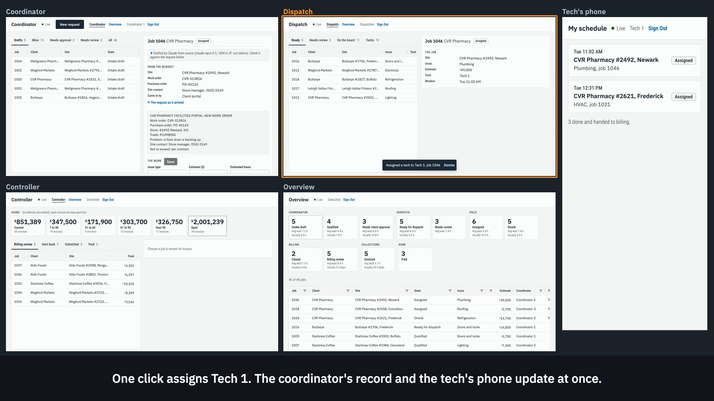
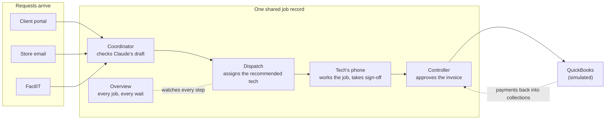
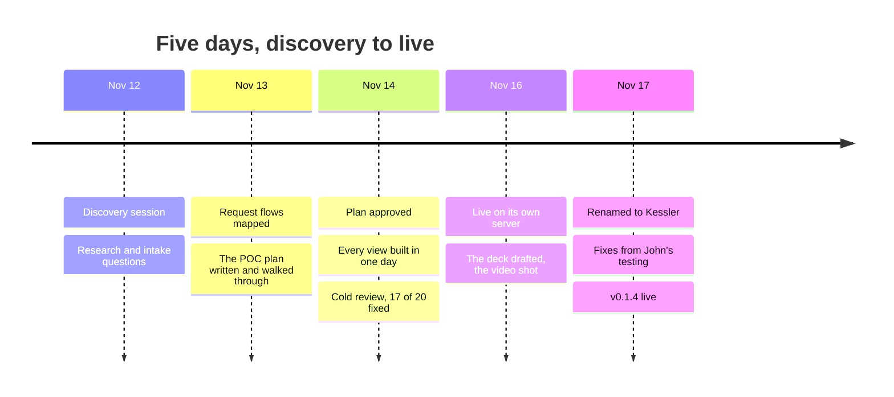
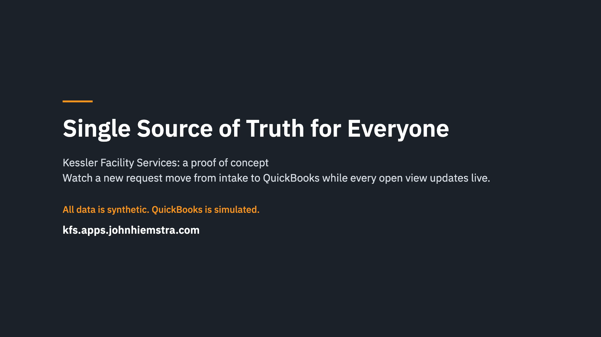

# Kessler Facility Services: a proof of concept

**One service request, one shared record, five live views.** Built by John Hiemstra Creative in five days, from
the first discovery call to a live app, with every decision written down along the way.

| ▶ Watch | ● Use | ☰ Read |
|---|---|---|
| [**The 3-minute demo**](https://youtu.be/bLh9DnSz3Zo) | [**kfs.apps.johnhiemstra.com**](https://kfs.apps.johnhiemstra.com) | [**Where things stand today**](docs/status.md) |
| Five screens, one request, start to finish | Logins for every role are on page 9 of the PDF | Live version, rollback, what's next |

[](https://youtu.be/bLh9DnSz3Zo)

<sub>A still from the demo: dispatch assigns Tech 1, and the coordinator's record and the tech's phone update at
once. Click it to watch.</sub>

---

## Contents

1. [Start here: three stops, ten minutes](#1-start-here-three-stops-ten-minutes)
2. [What it does](#2-what-it-does)
3. [The map of this repo](#3-the-map-of-this-repo)
4. [How we built it](#4-how-we-built-it)
5. [Testing](#5-testing)
6. [The demo video, and Henry](#6-the-demo-video-and-henry)
7. [Run it yourself](#7-run-it-yourself)
8. [What it isn't](#8-what-it-isnt)

---

## 1. Start here: three stops, ten minutes

| | Stop | Time | What you get |
|---|---|---|---|
| **1** | [Watch the demo](https://youtu.be/bLh9DnSz3Zo) | 3 min | One request from intake to paid, in all five views at once |
| **2** | Read the PDF that came with our email | 5 min | Today's request flow, nine efficiencies with hours and priority, the case for one record |
| **3** | [Sign in](https://kfs.apps.johnhiemstra.com) as two roles, side by side | 2 min | A change in one view lands in the other within a second |

Then come back here for the code, the tests and the paper trail.

---

## 2. What it does

A request arrives from a client portal, a store's email or FacilIT. Claude drafts the job from it, and a person checks
the draft. From there the job moves through one record, and every role sees the same record change as it happens.



**The three ideas behind it**, each running live:

- **One record, five views.** Coordinator, dispatch, the tech's phone, the controller and an overview all read and
  write the same job. Nobody calls dispatch to ask where a job stands.
- **Software drafts; people decide.** Claude drafts each request and labels the draft as one. Nothing moves until a
  coordinator accepts it. When Claude can't answer, a rules-based draft takes over and says so.
- **The contract holds the line.** A client's price cap and approval rules sit on the record before a tech is sent.
  Work done without that approval is what turns into disputed invoices.

---

## 3. The map of this repo

Read in the order that suits you. Every folder below is linked.

### The product

| If you want to see | Open | What's inside |
|---|---|---|
| The backend | [`app/backend/ofs/`](app/backend/ofs) | FastAPI and Postgres: the job record, the state machine, the contract rules, Claude's intake |
| The screens | [`app/frontend/src/routes/`](app/frontend/src/routes) | React, one file per view; grids are AG Grid Community |
| The live updates | [`app/backend/ofs/ws.py`](app/backend/ofs/ws.py), [`app/frontend/src/live/`](app/frontend/src/live) | One WebSocket; a dropped view replays what it missed |
| How a request becomes a draft | [`app/backend/ofs/intake.py`](app/backend/ofs/intake.py) | Claude's structured draft, and the rules that take over when it can't |
| Who gets recommended | [`app/backend/ofs/recommend.py`](app/backend/ofs/recommend.py) | Skill, license, distance and load, with the reasons shown |
| The synthetic data | [`app/backend/ofs/seed.py`](app/backend/ofs/seed.py) | 8 clients, 60 sites, 10 techs, 45 jobs in every state; the same seed always makes the same data |
| The deploy | [`app/scripts/`](app/scripts) | The gate, the browser tests, the ship script and the post-deploy check |

### The thinking

| If you want to know | Open | What's inside |
|---|---|---|
| Where things stand today | [`docs/status.md`](docs/status.md) | Live version, rollback, what's next. Overwritten, never appended |
| What we heard from you | [`docs/meetings/`](docs/meetings) | Discovery notes from the round 4 session |
| What we looked up | [`docs/research/`](docs/research) | FacilIT, the vendors, the chains' rules |
| The plan we built to | [`docs/plans/`](docs/plans) | The POC plan, the test strategy, the final presentation |
| Why we chose what we chose | [`docs/adr/`](docs/adr) | Five decisions, each with the options we turned down |
| The flow diagrams and the deck | [`docs/flow/`](docs/flow) | The request flows as data, and the deck's pages as editable HTML in [`docs/flow/final/`](docs/flow/final) |
| What shipped, and when | [`docs/releases/`](docs/releases) | v0.1.0 to v0.1.4, each with its evidence and its rollback |

### The process, and our navel gazing

| If you want to know | Open | What's inside |
|---|---|---|
| How every session ended | [`docs/carry-forward/`](docs/carry-forward) | Dated notes: what landed, what's open, what we learned |
| The build day, hour by hour | [`docs/journal/2026-11-14-build/`](docs/journal/2026-11-14-build) | Every commit, every decision, every defect, every number, each with its source |
| What we found wrong in our own work | [`docs/backlog/2026-11-14-cold-review.md`](docs/backlog/2026-11-14-cold-review.md) | A fresh reviewer's 20 findings: 17 fixed, 3 accepted and why |
| Proof each screen worked when built | [`docs/evidence/`](docs/evidence) | Screenshots taken as each story closed |
| How the team works | [`CLAUDE.md`](CLAUDE.md) | Who owns what, the constraints John set, the calendar |

---

## 4. How we built it

John led a team of AI agents, each with one role and one set of rules: a product owner, a scrum master, backend
and frontend leads, a test architect, a technical director, a security director, a design advisor, an editor and a
video editor. They work to written gates. Nothing starts without a plan and nothing ships without a green gate.
Production deploys wait on John's go.



**The habits that show up all through the repo:**

- **Plans before code.** Each story had acceptance criteria before work started ([the plan](docs/plans/2026-11-13-poc-plan.md)).
- **Decisions get written down.** Each ADR keeps the options we turned down and why.
- **A fresh reviewer, every time.** Code is reviewed cold by an agent that didn't write it.
- **Evidence over claims.** Every release note names the test run, the live check and the commit behind it.
- **Every session ends on paper.** Status, release notes and a carry-forward note, so the next session starts warm.

---

## 5. Testing

Four layers, each run before every deploy, and one more against the live site after it.

| Layer | Tool | Count | What it proves |
|---|---|---|---|
| **Backend** | pytest, on real Postgres | **116 tests** | State machine, contract rules, roles, live updates and replay, intake, recommendation, seed |
| **Backend coverage** | coverage.py, line and branch | **92%** | The state machine, contract rules, recommendation and models at 100%; the login CLI runs by hand, untested |
| **Frontend unit** | Vitest | **11 tests** | The live store's ordering and replay; the sign-in paste cleanup |
| **Browser e2e** | Playwright, real Chromium, the real stack | **15 tests** | Each role's happy path; two browsers at once, a change in one seen in the other |
| **After deploy** | [`check-live.py`](app/scripts/check-live.py) | **7 checks** | Health, headers, no indexing, sign-in cookie flags, and a new request reaching an open view live |

Also on every gate: Ruff lint and format, mypy, TypeScript, the frontend types checked against the backend's schema,
the database migrations checked against the models, and a size budget on every JavaScript bundle.

**Two evaluations, reported as counts:** the tech recommendation matches **20 of 20** hand-checked cases, and the
rules-based drafting gets every field right on **60 of 60** synthetic requests.

**What we chose not to test**, and why, is in [the test strategy](docs/plans/2026-11-14-test-strategy.md): live
Claude calls in the gate (cost, nondeterminism), real QuickBooks or portals (simulated), load (a demo's worth of
users) and pixel-level visual diffs (reviewed by eye against the house UI rules).

```bash
app/scripts/gate.sh       # lint, types, migrations, 116 backend + 11 frontend tests, the build and its budget
app/scripts/e2e.sh        # rebuilds the stack, reseeds it, runs 15 browser tests
app/scripts/coverage.sh   # the backend tests again, measured line by line
```

---

## 6. The demo video, and Henry

[](https://youtu.be/bLh9DnSz3Zo)

**[Watch it on YouTube](https://youtu.be/bLh9DnSz3Zo)**, 3 minutes, captioned.

Henry is the team's video editor, and he made this one on his own from the team's scripts. Nobody screen-recorded
anything. He wrote [`take.sh`](app/frontend/video/take.sh), which resets the app to clean demo data and runs
[`record.mjs`](app/frontend/video/record.mjs), a Playwright script that signs in as all five roles in five browsers
and walks one request from intake to paid. If the take came out wrong, say the wrong tech was recommended, he threw it
away and ran it again. [`render.mjs`](app/frontend/video/render.mjs) then cuts the five recordings into one grid from
[an edit list](docs/delivery/video/edl.json), highlights the view that's acting, adds the captions and lays in the
music. When we found the invoice was pricing labor wrong, the fix went in and Henry reshot the whole thing.

<sub>Music: "Coastline" by Hara Noda (Epidemic Sound).</sub>

---

## 7. Run it yourself

You need Docker, Python 3.12 and Node 22.

```bash
cd app
scripts/init-env.sh                       # writes app/.env with generated local secrets
docker compose up -d --wait --build       # Postgres, migrations, the API and the web app
docker compose exec backend python -m ofs.seed
open http://localhost:9219
```

Then make the five logins: from `app/backend`, run `python -m ofs.logins --file <a path outside the repo>` with
`DATABASE_URL` pointing at the local Postgres, the way [`e2e.sh`](app/scripts/e2e.sh) does. It generates the
passwords straight into that file and stores only their hashes. No password is ever committed.

---

## 8. What it isn't

- **Not real data.** Every client, site, tech and job is synthetic, and the same seed always makes the same data.
- **Not real integrations.** QuickBooks, the fleet trackers and the client portals are simulated. The contracts
  between them and the record are real.
- **Not production.** One server, a demo's worth of users, and it comes down after the review.

The point is the shape: one record that every role trusts, built small, tested hard and documented as we went.

---

<sub>John Hiemstra Creative · Product engineering · [johnhiemstra.com](https://johnhiemstra.com)</sub>
